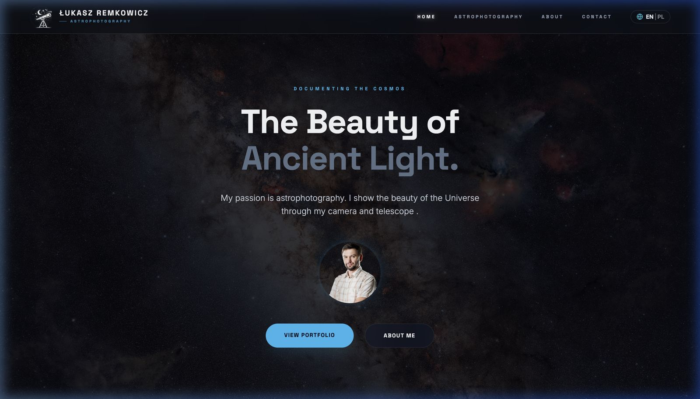
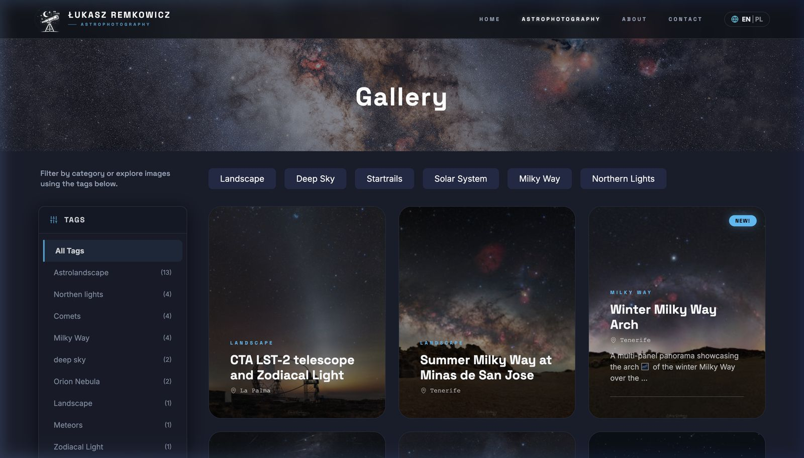
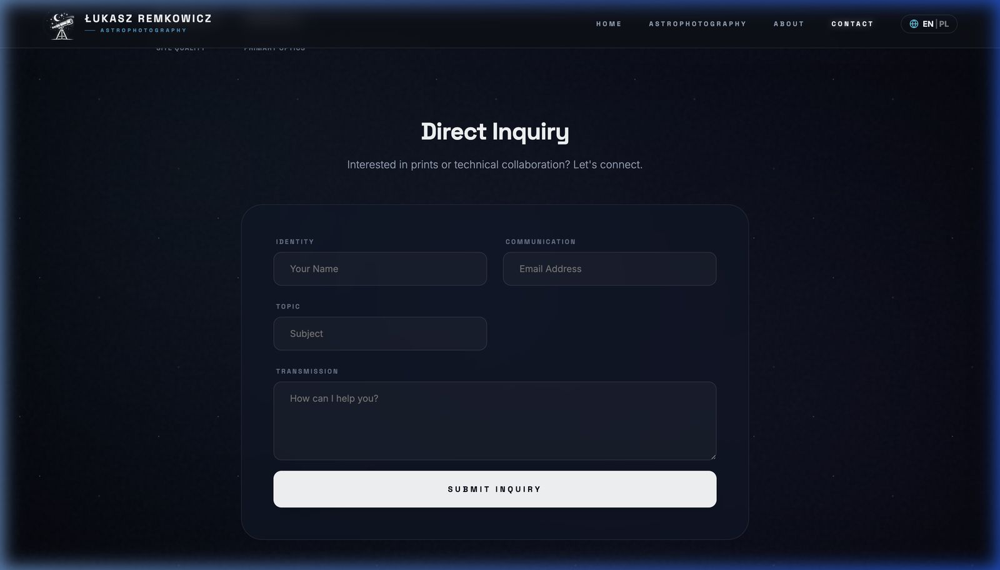
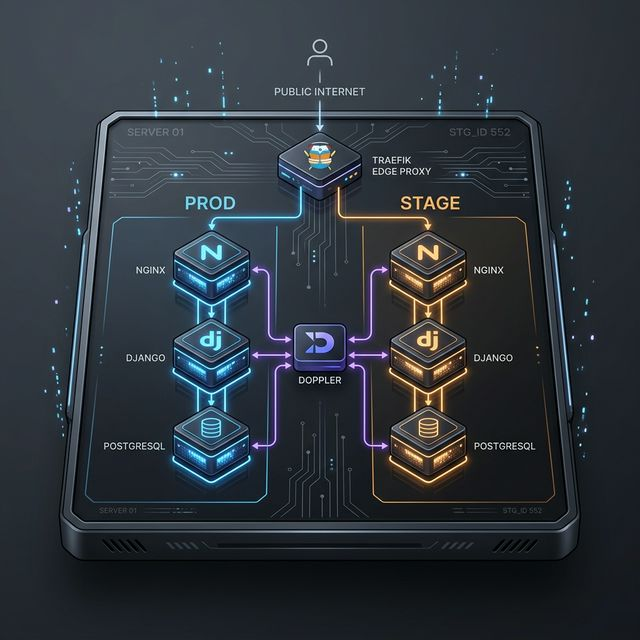

# 🌌 Portfolio Landing Page

Personal portfolio web app for astrophotography, travel stories, and programming work. The stack is:

- backend: Django + DRF
- edge/static layer: nginx
- secrets: Doppler

The frontend lives in [`LukaszRemkowicz/portfolio-fe`](https://github.com/LukaszRemkowicz/portfolio-fe) and runs on Cloudflare Workers. Workers routes send `/media/*`, `/static/*`, `/app/image-files/*`, `/v1/*` and `/sitemap.xml` to this stack (Traefik, nginx); every other path on the main domain is served by the Worker.

Fallback: nginx still proxies the main domain to the last frontend container (`fe`, image `production-fe`), which keeps running on the VPS although it is no longer in compose or deploys. Removing the Workers route `lukaszremkowicz.com/*` in Cloudflare instantly serves the old frontend again. Do not remove that container while nginx references `frontend_upstream`; nginx would fail to start.

## 🌍 Live

- Site: [lukaszremkowicz.com](https://lukaszremkowicz.com)

## 🗂️ Repository Layout

- `backend/` - Django + DRF application, admin, Celery jobs, and media logic
- `docker/` - Dockerfiles and entrypoints for backend, redis, and nginx
- `infra/` - nginx templates, release scripts, and project docs
- `screenshots/` - README screenshots

Component docs:

- Backend: [backend/README.md](backend/README.md)
- Infra scripts: [infra/scripts/README.md](infra/scripts/README.md)

## 📸 Screenshots

<details>
<summary><b>Click to expand screenshots</b></summary>

### Home Page


### Astrophotography Gallery


### Contact Form


</details>


## 🏗️ Architecture

The project follows a modern, highly decoupled architecture for performance and security. It supports **Environment Isolation** (Production & Staging) on the server, with an identical stack for **Development** (Local):



### Key Components:
- **Environment Isolation**: Parallel stacks (`PROD` and `STAGE`) ensure zero-collision deployments.
- **Development Stack**: Local development uses the same core `Nginx + Django + PostgreSQL` architecture via `portfolio-dev`.
- **Doppler**: Secret management for project runtime configuration.


Current request flow:

1. browser requests `SITE_DOMAIN`; Cloudflare Workers serves pages and forwards `/media/*`, `/static/*`, `/app/image-files/*`, `/v1/*` and `/sitemap.xml` to the VPS
2. Traefik routes those requests to nginx
3. nginx serves public static/media directly or proxies the request to Django; any other path returns 404

Application structure:

- public page URLs are the normal website addresses used by users, search engines, and the sitemap
- the browser uses `SITE_DOMAIN` as its public application host
- Django remains the content owner and still handles sitemap generation

## 📖 Glossary

- `SITE_DOMAIN`: Public website host, for example `portfolio.local`.
- `ADMIN_DOMAIN`: Public Django admin host, for example `admin.portfolio.local`.
- `API`: Internal backend API contract used by the Workers frontend and Django admin integrations.

## 🧭 Architecture Overview

### Public entrypoints

- `SITE_DOMAIN`
  - public website
  - public website (frontend on Cloudflare Workers; only API, media, static and sitemap paths reach this stack)
  - public media served by nginx
- `ADMIN_DOMAIN`
  - Django admin

### Backend responsibilities

- content ownership and business logic
- admin application
- API used by the Workers frontend
- sitemap generation
- secure media authorization/signing

### Media Delivery

Public-safe media is served directly by nginx on `SITE_DOMAIN`.

Protected media uses a split flow:

- Django signs or authorizes access
- nginx serves file bytes through `X-Accel-Redirect`

### Observability

The backend echoes and logs `X-Request-ID` when the frontend forwards it.

Operational log and sitemap monitoring is handled outside this repository by
the standalone `agent-monitoring` project. Landingpage emits structured logs
and still owns public sitemap generation, but it no longer stores monitoring
reports or exposes Django admin monitoring actions.

## ⚡ Quick Start

Local development is Docker Compose only. This project is not maintained as a standalone `manage.py runserver` workflow.

### ✅ Prerequisites

- Docker with the Compose plugin
- Doppler CLI with access to the project secrets
- `/etc/hosts` access for local domain mapping

### 1. Clone

```bash
git clone <your-repo-url>
cd landingpage
```

### 2. Configure secrets with Doppler

```bash
doppler login
doppler setup
```

### 3. Bootstrap local Docker resources

The local Compose stack expects these external Docker resources to already exist:

```bash
docker network create traefik_proxy || true
docker volume create portfolio_dev_db_data || true
docker volume create portfolio_dev_static_data || true
```

### 4. Configure local hosts

Add these entries to `/etc/hosts`:

```text
127.0.0.1 portfolio.local
127.0.0.1 admin.portfolio.local
127.0.0.1 api.portfolio.local
```

### 5. Start local stack

```bash
doppler --config dev run -- docker compose up --build
```

Local hosts:

- Site: `https://portfolio.local/`
- Admin: `https://admin.portfolio.local/`
- API: `https://api.portfolio.local/` (still available as a backend host, but no longer the normal browser-facing application entrypoint)
- Django health endpoint: `http://127.0.0.1:8000/health`
- Flower: `http://127.0.0.1:5555/`

### 6. Verify local services

```bash
curl -k https://portfolio.local/
curl -k https://admin.portfolio.local/
curl -fsS http://127.0.0.1:8000/health
```

## 🛠️ Local Development

Use Docker Compose for all normal local work:

```bash
doppler --config dev run -- docker compose up --build
```

Common commands:

```bash
# stop the stack
doppler --config dev run -- docker compose down

# restart one service
doppler --config dev run -- docker compose restart be

# show logs
doppler --config dev run -- docker compose logs -f be nginx

# run backend management commands
doppler --config dev run -- docker compose exec -T be python manage.py migrate
```

## 🧰 Useful Commands

Run everything from the repository root unless noted otherwise.

### Backend

General pattern for Django management commands:

```bash
doppler --config dev run -- docker compose exec -T be python manage.py <command> [args]
```

Clear the full Django cache:

```bash
doppler --config dev run -- docker compose exec -T be python manage.py clear_cache
```

Backfill responsive image variants:

```bash
# generate missing variants
doppler --config dev run -- docker compose exec -T be python manage.py backfill_image_variants

# preview only
doppler --config dev run -- docker compose exec -T be python manage.py backfill_image_variants --dry-run

# regenerate all variants from originals
doppler --config dev run -- docker compose exec -T be python manage.py backfill_image_variants --force

# convert one object
doppler --config dev run -- docker compose exec -T be python manage.py backfill_image_variants --object-id <uuid>

# convert multiple objects
doppler --config dev run -- docker compose exec -T be python manage.py backfill_image_variants --object-ids <uuid1> <uuid2>
```

Regenerate thumbnails:

```bash
doppler --config dev run -- docker compose exec -T be python manage.py regenerate_thumbnails
doppler --config dev run -- docker compose exec -T be python manage.py regenerate_thumbnails --force
```

### Custom management commands in this repository

- `clear_cache`
  - clears the active Django cache backend
  - run:
    ```bash
    doppler --config dev run -- docker compose exec -T be python manage.py clear_cache
    ```
- `backfill_image_variants`
  - generates missing responsive `ImageVariant` rows from original images
  - run:
    ```bash
    doppler --config dev run -- docker compose exec -T be python manage.py backfill_image_variants
    ```
- `regenerate_thumbnails`
  - rebuilds thumbnails using current thumbnail settings
  - run:
    ```bash
    doppler --config dev run -- docker compose exec -T be python manage.py regenerate_thumbnails
    ```
- `seed_settings`
  - creates or repairs singleton landing page settings and meteors config
  - run:
    ```bash
    doppler --config dev run -- docker compose exec -T be python manage.py seed_settings
    ```
- `seed_regions`
  - seeds region and sub-place data used by travel highlights
  - run:
    ```bash
    doppler --config dev run -- docker compose exec -T be python manage.py seed_regions
    doppler --config dev run -- docker compose exec -T be python manage.py seed_regions --dry-run
    doppler --config dev run -- docker compose exec -T be python manage.py seed_regions --retranslate
    ```
- `fix_parler_language_codes`
  - rewrites legacy `en-us` Parler translations to `en`
  - run:
    ```bash
    doppler --config dev run -- docker compose exec -T be python manage.py fix_parler_language_codes
    ```

### Common built-in Django commands

```bash
doppler --config dev run -- docker compose exec -T be python manage.py migrate
doppler --config dev run -- docker compose exec -T be python manage.py makemigrations
doppler --config dev run -- docker compose exec -T be python manage.py createsuperuser
doppler --config dev run -- docker compose exec -T be python manage.py shell
doppler --config dev run -- docker compose exec -T be python manage.py collectstatic --noinput
doppler --config dev run -- docker compose exec -T be python manage.py compilemessages
```

Standalone local development commands such as `python manage.py runserver` are not the supported workflow described by this repository.

## 🧪 Testing And Checks

Typical project checks:

```bash
# backend test suite
doppler --config dev run -- docker compose exec -T be uv run pytest

# backend static analysis
doppler --config dev run -- docker compose exec -T be uv run mypy .
```

Compose also exposes dedicated test services:

```bash
doppler --config dev run -- docker compose --profile test run --rm test
```

## 🚀 Deployment

Typical release flow:

```bash
# Build images
doppler run -p portfolio -c portfolio-prod -- ./infra/scripts/release/build.sh

# Deploy on server
doppler run -p portfolio -c portfolio-prod -- ./infra/scripts/release/deploy.sh
```

Production/stage deploys rebuild:

- `nginx` when routing or public media rules change
- `be` when invalidation, serializers, or backend routes change

## 🔧 Operations

## 📝 Notes

- Python dependency and tool configuration live in [backend/pyproject.toml](backend/pyproject.toml).
- Local startup runs Django migrations, `seed_settings`, message compilation, and `collectstatic` automatically as part of the `be` service command.

### Cache Invalidation

Frontend SSR cache invalidation is disabled (`SSR_CACHE_INVALIDATION_URL` is empty) since the frontend moved to Cloudflare Workers. See `infra/docs/project/cache_invalidation.md`.


## 💾 Database Backup & Maintenance

Database maintenance scripts are located in `infra/scripts/db_backup/`.

### 1. Manual Backup
Create a compressed SQL dump of the production database:
```bash
./infra/scripts/db_backup/backup_db.sh
```
The backup should be stored outside the repository, for example in `/var/backups/portfolio/`.

### 2. Testing Restores
Always verify your backups by running a test restore:
```bash
./infra/scripts/db_backup/test_restore.sh
```
This script creates a temporary container and verifies that the SQL dump is valid and can be fully imported.

See [Backup Maintenance Guide](infra/scripts/db_backup/MAINTENANCE.md) for more details.

## Testing

### Backend (Dedicated Service)
The backend tests now run in a dedicated, isolated environment using Docker Compose Profiles. This inherits your development configuration but remains isolated.

```bash
doppler --config dev run -- docker compose run --rm test
```

## 🔄 Release Lifecycle

To ensure version traceability and zero-downtime, follow this mandatory flow for all new features and fixes:

### 1. Development to Dev
- **Merge Request**: Create an MR from your feature branch to `dev`.
- **Squash & Delete**: Perform a **Squash and Merge** and delete the feature branch to keep history clean.

### 2. Versioning (Tags)
- **Tag the Commit**: Once code is on `dev`, tag it with a version (e.g., `v1.2.0`).
- **Push Tag**: `git push origin v1.2.0`
- **Automatic Detection**: The `build.sh` and `deploy.sh` scripts automatically detect this tag and use it as the Docker image reference.

### 3. Promotion to Main
- **Merge Request**: Merge `dev` into `main`.
- **Production Anchor**: This ensures `main` always stable and aligned with a specific Git tag.

### 4. Direct Deployment
On your production server, simply run:
```bash
# TAG is auto-detected from the Git tag on main
./infra/scripts/release/deploy.sh
```

> [!IMPORTANT]
> **Production Requirement**: Deployments **must** use a Git tag as the reference. This allows for instant rollbacks by just changing the `TAG` variable.

---


## Component Docs

- Backend: [backend/README.md](backend/README.md)


### TODO:
- fix small visual issues in django admin
