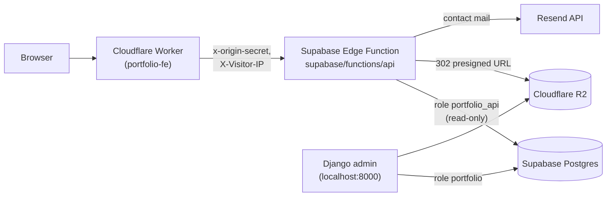

# Supabase API and Local Admin

The public read API and the contact form run as a Supabase Edge Function over the
Supabase Postgres database. The Django admin runs on your own machine against the
same database. This replaces the VPS for public traffic; the former DRF API was removed from
Django (see git history for the reference implementation).

## Request Path



- The FE Worker calls the function with `SSR_API_URL` (the function URL) and adds
  `x-origin-secret` from the `API_ORIGIN_SECRET` Worker secret. The browser never
  calls the function directly.
- Media links in API responses point at `https://$SITE_DOMAIN/image-files/...`;
  the FE rewrites them to `/app/image-files/...`, the Worker proxies them and the
  function answers 302 with a short-lived presigned R2 URL.

## Edge Function (`supabase/functions/api`)

- 1:1 port of the former DRF read endpoints: same paths, query params, status codes and
  JSON.
- Hidden API: `router.ts` first requires `API_ORIGIN_SECRET` to be set (else a bare
  503), then `x-origin-secret` to match (else 403), before any routing or DB work.
- Media signing uses `MEDIA_SIGNING_KEY` (HMAC over `slug:expiry`), separate from
  Django's `SECRET_KEY`. Like Django on R2, the serve endpoint does not check that
  the file exists; a missing file ends in R2's own XML error.
- DB: postgres.js, one connection per isolate, prepared statements. Deployed it
  uses the direct connection (`db.<ref>.supabase.co:5432`); local runs use the
  session pooler (port 5432). Never the transaction pooler (6543): it breaks
  prepared statements. `db.ts` drops a null write to the TLS socket: under Deno a
  cancelled postgres.js write timer can still fire, and that throw used to kill the
  isolate (bursts of empty 503s).
- `/sitemap.xml` (`sitemap.ts`) is built from the database on every request; the FE
  Worker serves it on the site domain. A new FE page with a fixed URL must be added
  to it.
- Local checks, in `supabase/functions/api`: `deno task test`, `deno task check`,
  `deno task lint`, `deno task fmt:check`; `deno task serve` runs it on :8001.

### Contact form (`POST /v1/contact/`)

Ported from the former Django view: kill switch (`contact_form_enabled`), throttle before
validation (per IP 5/h, per email 3/h, IP+email 2/h), payload limit, DRF
validation messages, 5-minute duplicate check, then two mails.

- `portfolio_api` has no rights on `inbox_contactmessage`. It may only execute
  `api_private.contact_throttle` and `api_private.contact_submit` (SECURITY
  DEFINER, owned by `portfolio`), so the API can add a message but never read
  stored ones. Both are called in `begin read write` transactions because the
  role defaults to read-only.
- Mail goes through the Resend HTTP API (`mail.ts`); Supabase blocks outbound SMTP
  ports 25 and 587. Sender `kontakt@$SITE_DOMAIN`; the owner notification replies
  to the visitor, the confirmation replies to `CONTACT_EMAIL`. Templates in
  `contact_emails.ts` are ports of the Django templates in `backend/inbox/`.
  Mail failures are logged and never change the 201.
- The Supabase gateway overwrites `X-Real-IP` and `X-Forwarded-For` with the
  caller's IP (the Worker). The Worker therefore sends the visitor IP in
  `X-Visitor-IP`, which the function trusts only after the origin secret check.

### Gateway behaviour to remember

- `text/html` responses are rewritten to `text/plain` (no custom domain), so HTML
  error pages show as source text when opened directly. `application/xml` is
  rewritten too, so the FE `/sitemap.xml` route sets the XML type itself.
- Malformed `%`-encoding is answered with 400 by the gateway before the function.

## Database Roles and Migrations (`supabase/migrations`)

- Django migrations own every table. Supabase migrations hold only roles, grants
  and the contact functions.
- `portfolio`: the Django role (admin, migrations). `portfolio_api`: read-only,
  explicit table allow-list, column grants where a table holds source-file paths
  (`astrophotography_astroimage`, background and shop tables).
- Order on a fresh project: the first two Supabase migrations, then Django
  `migrate`, then the remaining Supabase migrations (they grant on Django tables).
  A Django migration that recreates a table drops its grants: re-apply them.
- When the API needs a new table or column, grant it in a new migration.

## Deploy

```bash
doppler run --project portfolio --config prd -- supabase/deploy-api.sh
```

The script sets the function secrets from Doppler (DB, `MEDIA_SIGNING_KEY`,
`API_ORIGIN_SECRET`, R2, `RESEND_API_KEY`, `CONTACT_EMAIL`, `PROJECT_OWNER`,
`SITE_DOMAIN`) and deploys with the Supabase CLI (`npx supabase@2.121.0`).

## Local Production Admin

```bash
infra/scripts/run_admin.sh            # newest release tag
infra/scripts/run_admin.sh <release-tag>  # a release matching this checkout
```

Pulls the released `production-be` image from GHCR, runs `migrate` and
`createcachetable` and `reset_stuck_translation_tasks`, then serves the admin at http://localhost:8000/admin/
(`docker-compose.supabase.yml`, all config from Doppler). Background work
(image variants, translations) runs in-process: stop with Ctrl+C only after it
has finished. Nothing here touches the VPS.

This compose file requires an image from the release that includes this change or newer.
For an older release tag, use the matching Git checkout; older images lack the reset command.

Startup marks unfinished translation tasks from the previous process as failed; retry
those translations in the admin. If image work was interrupted, recover it with:

```bash
docker compose -f docker-compose.supabase.yml run --rm --no-deps admin python manage.py backfill_image_variants
docker compose -f docker-compose.supabase.yml run --rm --no-deps admin python manage.py recalculate_landing_page_total_time_spent --recalculate
```

Run these with the same `TAG`, GHCR and Doppler environment used for the admin.
`--no-deps` avoids starting the migrate/reset service alongside an active worker.

## Keep-alive and Backups

`.github/workflows/supabase-maintenance.yml` (runs from `main`):

- Every 6 hours (00:17, 06:17, 12:17, 18:17 UTC): one `psql` query against the
  database (session pooler, same secrets as the backup). Supabase pauses a free
  project after a week with too few database queries ("a few a day" is enough). Not
  through the site: Cloudflare's bot protection answers GitHub runners with 403.
- 1st of each month 03:23 UTC (or a manual run with "backup" ticked): `pg_dump`
  (custom format, schemas `public` and `api_private`) encrypted with
  `BACKUP_PASSPHRASE` and uploaded to the private R2 bucket as
  `portfolio-originals/backups/supabase/YYYY-MM-DD.dump.gpg`; dumps older than
  62 days are deleted. Free projects get no automatic Supabase backups.
- Needs repo secrets `SUPABASE_DB_HOST/PORT/NAME/USER/PASSWORD`,
  `R2_ACCESS_KEY_ID`, `R2_SECRET_ACCESS_KEY` and `BACKUP_PASSPHRASE` (same values
  as Doppler `portfolio/prd`). GitHub disables schedules in a public repo after
  60 days without commits; re-enable it in the Actions tab if that happens.
- Images are not in the dump: the database stores only R2 object keys.

Restore (Postgres 17 tools; roles from the Supabase migrations must exist):

```bash
gpg --decrypt 2026-12-01.dump.gpg > db.dump      # asks for BACKUP_PASSPHRASE
pg_restore --clean --if-exists --no-owner -d "$TARGET_DATABASE_URL" db.dump
```
